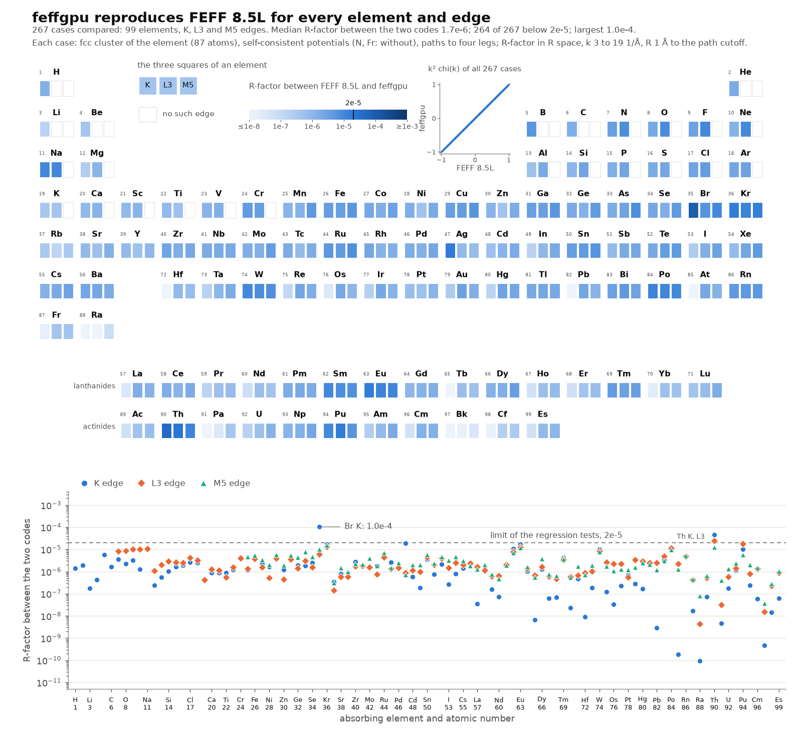
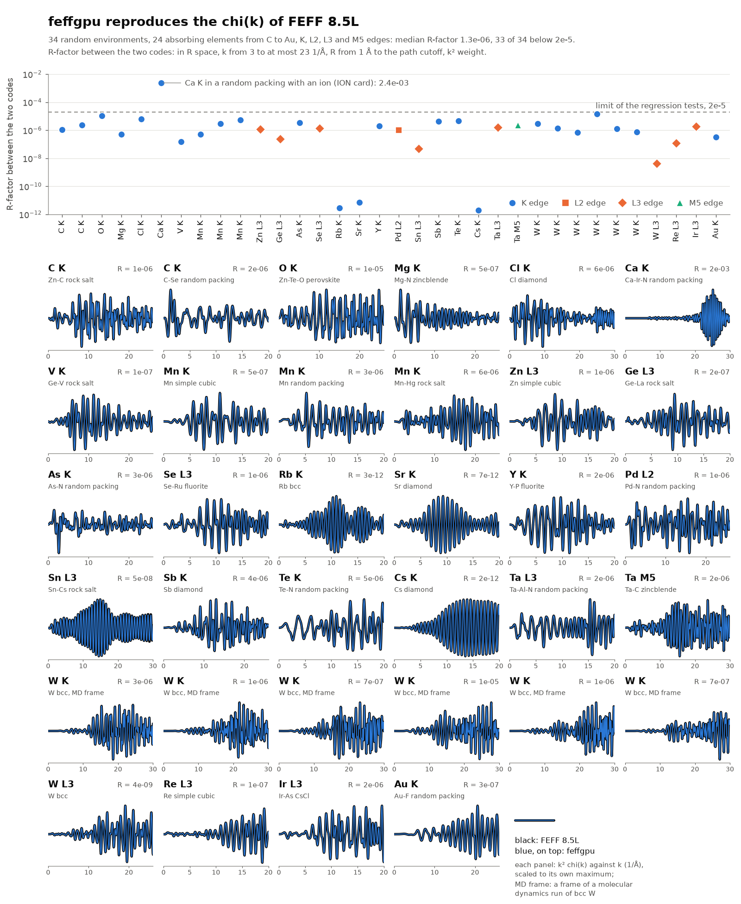
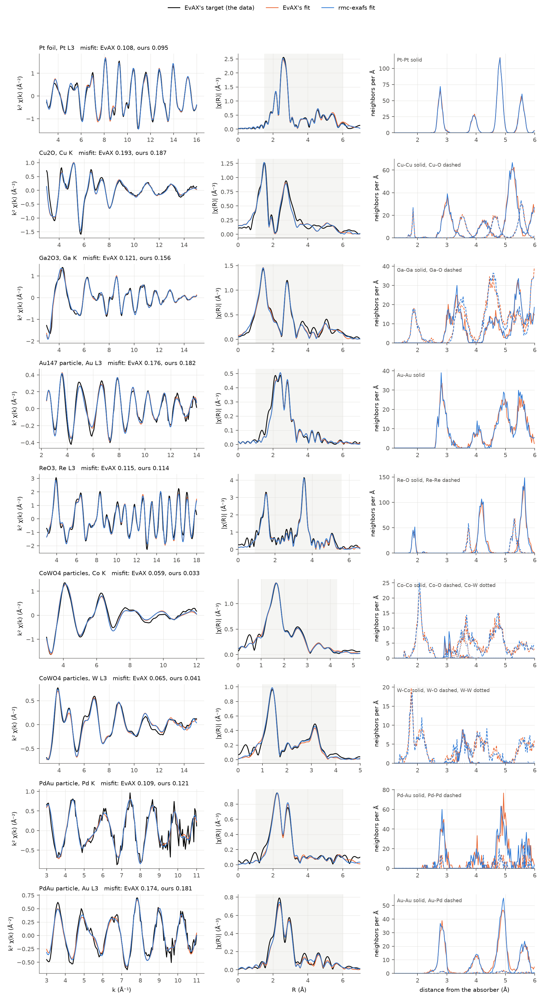

# feffgpu

FEFF 8.5L's EXAFS calculation rewritten in PyTorch for NVIDIA GPUs, with two tools built on it. One installation
gives all three:

| Tool | Command | What it does |
|---|---|---|
| **feffgpu** | `feffgpu` | a FEFF input file to chi(k): potentials with the self-consistency loop, phase shifts, the path finder and the path stage, validated against FEFF 8.5L; the path stage is batched over hundreds of thousands of paths and differentiable in the atom positions |
| **MD-EXAFS** | `md-exafs` | the EXAFS spectrum of any molecular dynamics trajectory, averaged over frames and absorbing atoms, with its decomposition by path type, radial distribution tools, and a comparison with a measured spectrum |
| **RMC-EXAFS** | `rmc-exafs` | reverse Monte Carlo fitting: the atoms of a model structure are moved until its spectra fit the measured ones. The default engine is a gradient refinement on the exact spectra (any elements, several edges, minutes on one GPU); a population search that follows the rules of EvAX is included. Commissioning against EvAX's published calculations is underway |

EXAFS is the extended X-ray absorption fine structure; chi(k) is the EXAFS signal as a function of the
photoelectron wave number k; FEFF is the program that calculates chi(k) from atom positions.

**Documentation:** <https://feffgpu.readthedocs.io> (sources in [`docs/`](https://github.com/nmarcella/feffGPU/tree/main/docs)).

## The same output as FEFF 8.5L

`feffgpu` is validated against FEFF 8.5L itself: the same `feff.inp` goes through both codes and the two chi(k) are
compared. The measure is the R-factor between the two codes: the squared difference of the Fourier transforms of the
two spectra, divided by the squared transform of FEFF's.

**Every element, edge by edge.** Every element from hydrogen to einsteinium, with each of its K, L3 and M5 edges:
267 cases. In the periodic table below, the three squares of an element are its three edges, colored by the R-factor.
The inset plots every point of every `feffgpu` spectrum against FEFF's.



- The median R-factor between the two codes is 1.7e-6. 264 of the 267 cases are below 2e-5, the limit that the
  regression tests enforce; the three above it are at 1.0e-4, 4.6e-5 and 2.5e-5.
- The Fermi levels of the self-consistent potentials agree to 5e-8 hartree in the median, 1.4e-5 at most.
- The number of paths, weighted by degeneracy, is identical in 252 cases. In the other 15 the two codes differ by a few
  three- and four-leg paths that sit at the threshold of the path filter, never in the single-scattering paths.
- The recipe, the two spectra of every case drawn over each other, and the table are in
  [docs/validation/elements.md](https://github.com/nmarcella/feffGPU/blob/main/docs/validation/elements.md).

**Mixed environments.** 34 environments drawn at random over elements, edges, structures and input cards, one panel
per absorbing element and edge, with FEFF 8.5L in black and `feffgpu` in blue on top, and above them the R-factor
between the two codes.



- 24 absorbing elements from C to Au; K, L2, L3 and M5 edges; lattices and random packings with disorder, vacancies,
  strain and surfaces; self-consistent and overlapped potentials; a range of FEFF input cards.
- The median R-factor between the two codes is 1.3e-6, and 33 of the 34 are below 2e-5. The one above it (2.4e-3) is a
  random packing with an `ION` card.
- The number of paths, weighted by degeneracy, is identical in 29 of the 34. In the other 5 the two codes differ by
  one path that sits at the importance threshold. The Fermi levels agree to 2e-6 hartree or better.

The full table is in [docs/validation/random_environments.md](https://github.com/nmarcella/feffGPU/blob/main/docs/validation/random_environments.md). The spectra
behind both figures are in `data/validation/`, and `tools/plot_validation_elements.py` and
`tools/plot_validation_agreement.py` redraw them.

## Please cite FEFF and EvAX

This package exists because FEFF exists, and its reverse Monte Carlo search follows the rules of EvAX. If you use
it, please cite that work as you would if you had used those programs themselves.

Always, FEFF:

- J. J. Rehr, J. J. Kas, F. D. Vila, M. P. Prange and K. Jorissen, Phys. Chem. Chem. Phys. **12**, 5503–5513 (2010).
  https://doi.org/10.1039/B926434E
- A. L. Ankudinov, B. Ravel, J. J. Rehr and S. D. Conradson, Phys. Rev. B **58**, 7565–7576 (1998).
  https://doi.org/10.1103/PhysRevB.58.7565
- J. J. Rehr and R. C. Albers, Rev. Mod. Phys. **72**, 621–654 (2000). https://doi.org/10.1103/RevModPhys.72.621
- The open-source FEFF 8.5L release that this package follows: `feff85exafs`, https://github.com/xraypy/feff85exafs
  (copyright University of Washington), distributed with Larch: M. Newville, J. Phys.: Conf. Ser. **430**, 012007
  (2013). https://doi.org/10.1088/1742-6596/430/1/012007

When you use RMC-EXAFS, EvAX:

- J. Timoshenko, A. Kuzmin and J. Purans, Comput. Phys. Commun. **183**, 1237–1245 (2012).
  https://doi.org/10.1016/j.cpc.2012.02.002
- J. Timoshenko, A. Kuzmin and J. Purans, J. Phys.: Condens. Matter **26**, 055401 (2014).
  https://doi.org/10.1088/0953-8984/26/5/055401
- For the wavelet residual: J. Timoshenko and A. Kuzmin, Comput. Phys. Commun. **180**, 920–925 (2009).
  https://doi.org/10.1016/j.cpc.2008.12.020

A citation entry for this package is in [CITATION.cff](https://github.com/nmarcella/feffGPU/blob/main/CITATION.cff). The full list with titles is in the
documentation page "How to cite".

## Install

Requirements: Linux, Python 3.11 or newer, an NVIDIA GPU with a CUDA build of PyTorch.

```bash
python -m venv venv && source venv/bin/activate
pip install torch --index-url https://download.pytorch.org/whl/cu126     # the CUDA build that matches your driver
pip install feffgpu                                                       # a release; or the current repository:
# pip install --upgrade git+https://github.com/nmarcella/feffGPU.git
feffgpu doctor                                                            # check the installation
```

FEFF's free-atom table, which the potentials need, ships inside the package (81 MB), so nothing else has to be
downloaded.

Optional extras: `feffgpu[mace]` (run new dynamics with MACE potentials), `feffgpu[mda]` (MDAnalysis trajectory
reader), `feffgpu[larch]` (xraylarch), `feffgpu[mcp]` (the server for agents), `feffgpu[docs]`, `feffgpu[test]`.

## Use

**FEFF on the GPU**

```bash
feffgpu feff.inp --out chi.dat            # chi(k) with S0² = 1 and no Debye-Waller factor, like FEFF's chi.dat
feffgpu phase feff.inp phase.pkl          # potentials and phase shifts only: the phase file for the other two tools
```

```python
from feffgpu import run
out = run("feff.inp", device="cuda")      # out["k"], out["chi"], out["phase"], out["kept"], out["counts"], out["timing"]
```

**MD-EXAFS**: one TOML file names the trajectory, the absorbing element and the phase file.

```bash
md-exafs validate config.toml
md-exafs run config.toml                  # the averaged spectrum, its parts by path type, an HDF5 cache
md-exafs rdf config.toml                  # radial distributions and shell statistics
md-exafs compare mdexafs_out              # against a measured spectrum: R-factor, S0² and the E0 shift with intervals
```

**RMC-EXAFS**: one TOML file names the start structure, the measured spectra and the phase files.

```bash
rmc-exafs validate config.toml
rmc-exafs refine config.toml              # the default: gradient refinement; any elements, several edges
rmc-exafs run config.toml                 # the population search under EvAX's rules (exchanges, hops, several samples)
rmc-exafs shells runs/my_fit --shell Zn-C:1.8:2.6      # N, R, MSRD by integration
rmc-exafs plot runs/my_fit                # the fits and the pair distributions
rmc-exafs from-evax start.dat my_run      # the same problem as an EvAX calculation: structure, spectra, rmc.toml
```

`md-exafs example` and `rmc-exafs example` list commented example configurations; `md-exafs schema` and
`rmc-exafs schema` print every key. Examples that generate their own synthetic inputs are in
[`examples/`](https://github.com/nmarcella/feffGPU/tree/main/examples). The quick starts are in the documentation.

## RMC-EXAFS: commissioning against EvAX (underway)

RMC-EXAFS is being commissioned against calculations that the authors of EvAX publish with their inputs and outputs
([the EvAX library](https://www.dragon.lv/evax/library.html)). Each calculation is translated with
`rmc-exafs from-evax`, fitted with `rmc-exafs refine` against EvAX's own target with EvAX's choice of scattering
paths, and compared with EvAX's output files. EvAX itself is not run. The misfit is EvAX's own measure.

| Calculation | Atoms | EvAX's run | `rmc-exafs refine` | Misfit: EvAX | Misfit: this package |
|---|---|---|---|---|---|
| Pt foil, Pt L3 edge | 500 | 17 h | 10 min | 0.108 | 0.095 |
| Cu2O, Cu K edge | 384 | 44 h | 12 min | 0.193 | 0.187 |
| Ga2O3, Ga K edge | 480 (here 600) | 23 h | 20 min | 0.121 | 0.156 |
| Au147 particle, Au L3 edge | 147 | 31 h | 8 min | 0.176 | 0.182 |
| ReO3, Re L3 edge | 256 | 27 h | 32 min | 0.115 | 0.114 |
| CoWO4 particles, Co K and W L3 edges in one fit | 1536 | 39 h | 33 min | 0.059 and 0.065 | 0.033 and 0.041 |
| PdAu particle, Pd K and Au L3 edges in one fit | 336 | 26 h | 41 min | 0.109 and 0.174 | 0.121 and 0.181 |



Black: EvAX's target. Orange: EvAX's fit and final atoms. Blue: this package's fit and final atoms.

- All runs use the same settings: EvAX's start lattice with random displacements of 0.05 Å, EvAX's choice of paths
  (up to six legs for ReO3 and CoWO4), S0² and the E0 shift held as in EvAX.
- Shell distances of the two final structures agree within 0.004 Å in the crystals and within 0.010 Å in the Au147
  particle and the Au-Au shells of the PdAu particle; shells of few pairs differ by up to 0.03 Å.
- Where this package's misfit is the higher one (Ga2O3, Au147, PdAu), the start of 0.05 Å is too narrow for a
  strongly disordered sample: the shells end 10 to 40 % narrower than EvAX's. From wider starts earlier runs reached
  0.135, 0.170, and 0.101 with 0.174. The width of the start is an input that matters; a rule for it is still open.
- EvAX's run times are read from the dates of its output files (its parameter files ask for 12 or 16 threads; the
  processors used are not recorded); this package ran on one 12 GB GPU. These are single runs: the spread between
  independent refinements has not been measured yet.
- Still open: a rule for the start, the spread between runs, and one difference at the W edge of CoWO4 between
  EvAX's own spectrum and this package's spectrum of EvAX's atoms.

The full tables, what was checked underneath (the forward model against FEFF itself on EvAX's atoms, the lists of
paths) and the sources of the calculations are in
[docs/rmc/commissioning.md](https://github.com/nmarcella/feffGPU/blob/main/docs/rmc/commissioning.md). When you use RMC-EXAFS, cite EvAX ([docs/citing.md](https://github.com/nmarcella/feffGPU/blob/main/docs/citing.md)).

## Tutorials

Notebooks that run on Google Colab (which provides NVIDIA GPUs) or on your own computer, stored with their outputs
so that they can be read here: [`tutorials/`](https://github.com/nmarcella/feffGPU/tree/main/tutorials).

| | |
|---|---|
| [MD-EXAFS from a trajectory: a worked example with iron](https://github.com/nmarcella/feffGPU/blob/main/tutorials/01_md_exafs_iron.ipynb) | [](https://colab.research.google.com/github/nmarcella/feffGPU/blob/main/tutorials/01_md_exafs_iron.ipynb) |
| [MD-EXAFS with your own trajectory](https://github.com/nmarcella/feffGPU/blob/main/tutorials/02_md_exafs_your_trajectory.ipynb) | [](https://colab.research.google.com/github/nmarcella/feffGPU/blob/main/tutorials/02_md_exafs_your_trajectory.ipynb) |
| [RMC-EXAFS from an EvAX project: copper foil](https://github.com/nmarcella/feffGPU/blob/main/tutorials/03_rmc_exafs_from_evax.ipynb) (needs the files of the EvAX example) | [](https://colab.research.google.com/github/nmarcella/feffGPU/blob/main/tutorials/03_rmc_exafs_from_evax.ipynb) |

The data of the MD-EXAFS tutorials are synthetic: a short trajectory of bcc iron made with springs and a thermostat,
and a spectrum with a known S0² and E0 shift put in. The RMC-EXAFS tutorial works on the input and output files of
an EvAX calculation, which you provide.

## What to expect

- **Conventions** are xraylarch's (and so Athena's and Artemis's): the Hanning window by `kmin`, `kmax`, `dk`; the
  R-factor on the R window; S0² and the E0 shift on the model, one value per edge, shared between samples. FEFF's
  chi(k) has no Debye-Waller factor: disorder comes from the atom positions.
- **Validation** is against FEFF 8.5L itself (random environments with absorbers from C to Au, K, L and M edges,
  many structures and cards: median R-factor 1.3e-6 between the two codes, worst 2.4e-3) and against synthetic
  targets with known answers. Literature values are not used as a yardstick.
- **Limits**: EXAFS only (no XANES, polarization or spin); paths up to eight legs (nine for a FEFF input); NVIDIA GPUs; one GPU per run
  today. MD-EXAFS can be split over several GPUs and nodes with shards; a pool over several GPUs is planned and its
  access points are in place (`feffgpu.parallel`).
- **Agents**: an MCP server (`feffgpu-mcp`) lets an agent validate configurations, start runs as jobs, follow them
  and read results; `AGENTS.md` is the guide for agents that work on the code.

## Repository layout

```
src/feffgpu/        the package: the FEFF pipeline, exafs/ io/ analysis/ parallel/ (shared), md/, rmc/, mcp/
tests/              validation against FEFF's own outputs, the shared layer, MD-EXAFS, RMC-EXAFS, the agent interface
docs/               the documentation (Sphinx, Read the Docs)
examples/           runnable examples with synthetic inputs
tutorials/          notebooks for Google Colab or your own computer, with their synthetic data
tools/              the free-atom table builder and the random-environment validation (need a FEFF 8.5L build)
fortran/            the patch for feff85exafs and how to build the optional FEFF library
data/validation/    four random environments and two cases with long paths, with FEFF's own outputs (regression cases)
```

## Contributing

Contributions are welcome. See [CONTRIBUTING.md](https://github.com/nmarcella/feffGPU/blob/main/CONTRIBUTING.md); agents see [AGENTS.md](https://github.com/nmarcella/feffGPU/blob/main/AGENTS.md).

## License

MIT (see [LICENSE](https://github.com/nmarcella/feffGPU/blob/main/LICENSE)). `feffgpu` is based on FEFF 8.5L, copyright University of Washington; the notices that
its license requires, and the acknowledgments of EvAX and of the original MD-EXAFS, are in [NOTICE](https://github.com/nmarcella/feffGPU/blob/main/NOTICE). FEFF's
own source code is not included.
