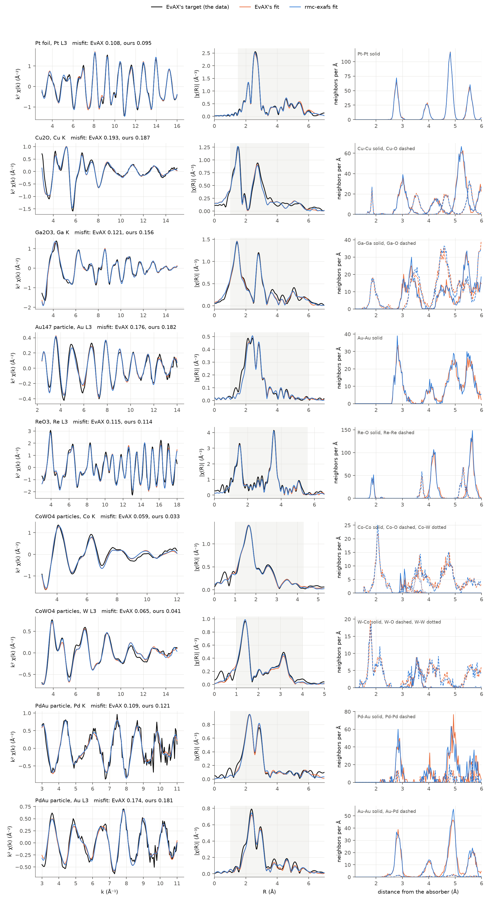

# Commissioning against EvAX (underway)

**Status, 14 November 2026: underway.** RMC-EXAFS is being commissioned against published calculations of EvAX
(J. Timoshenko, A. Kuzmin and co-workers), the established program for reverse Monte Carlo fits of EXAFS. This page
shows what has been compared so far and lists what is still open. The numbers are from single runs on one 12 GB
NVIDIA GPU, all with the same code and the same settings.

## What is compared

EvAX's authors publish a [library of finished calculations](https://www.dragon.lv/evax/library.html): for each, the
input files and the output files (the fitted spectrum, the final atoms, the list of scattering paths). For each
calculation below:

1. `rmc-exafs from-evax` translates EvAX's parameter file into the inputs of this package ([](evax_differences.md)).
   The fit gets what EvAX had: EvAX's own target spectrum, its cutoff, its choice of scattering paths
   (`criteria_rule = "evax"`, paths of up to as many legs as EvAX's `N_legs`), its wavelet misfit, its limit on the
   displacements, and potentials set up as EvAX sets them up. S0² and the E0 shift are held, as in EvAX.
2. `rmc-exafs refine`, the default engine ([](refinement.md)), fits the structure from EvAX's start lattice with
   random displacements of 0.05 Å, in 300 steps (100 for the Pt foil, 500 for the PdAu particle).
3. The result is put next to EvAX's output files. EvAX itself is not run.

The misfit in the table is EvAX's own measure: the root of the summed squared difference of the wavelet transforms
of model and target over the summed square of the target's. Three numbers are given for each spectrum: EvAX's own
(from its fitted spectrum), EvAX's final atoms put through the forward model of this package, and this package's fit.

## Results so far

| Calculation | Atoms | EvAX's run (threads) | `rmc-exafs refine` | Misfit: EvAX's own | EvAX's atoms, this forward model | This package's fit |
|---|---|---|---|---|---|---|
| Pt foil, Pt L3 edge | 500 | 17 h (16) | 10 min (100 steps) | 0.108 | 0.108 | 0.095 |
| Cu2O, Cu K edge | 384 | 44 h (16) | 12 min (300 steps) | 0.193 | 0.201 | 0.187 |
| Ga2O3, Ga K edge | 480 (here 600) | 23 h (16) | 20 min (300 steps) | 0.121 | not comparable | 0.156 |
| Au147 particle, Au L3 edge | 147 | 31 h (16) | 8 min (300 steps) | 0.176 | 0.188 | 0.182 |
| ReO3, Re L3 edge | 256 | 27 h (12) | 32 min (300 steps) | 0.115 | 0.117 | 0.114 |
| CoWO4 particles, Co K edge (both edges in one fit) | 1536 | 39 h (12) | 33 min (300 steps) | 0.059 | 0.076 | 0.033 |
| CoWO4 particles, W L3 edge (the same fit) | | | | 0.065 | 0.124 | 0.041 |
| PdAu particle, Pd K edge (both edges in one fit) | 336 | 26 h (16) | 41 min (500 steps) | 0.109 | 0.107 | 0.121 |
| PdAu particle, Au L3 edge (the same fit) | | | | 0.174 | 0.184 | 0.181 |

- **EvAX's run times** are read from the dates of its output files (from the first file written to the last). The
  number in brackets is `Number_of_threads` of its parameter file: the number of threads EvAX was told to start.
  The library's files do not record which processors were used, and the times were not measured here.
- **Where this package's misfit is the higher one** (Ga2O3, the Au147 particle, the PdAu particle), the cause is the
  start. These samples are strongly disordered (shell variances of 0.02 to 0.04 Ų); from a start of 0.05 Šthe
  refinement ends with narrower shells than EvAX's and a higher misfit. Earlier runs of the same code from wider
  starts (0.1 Å for Ga2O3 and Au147, 0.06 Å for the PdAu particle) reached 0.135, 0.170, and 0.101 with 0.174. For
  the stiff lattice of ReO3 it is the other way round: from 0.1 Å the fit kept too much disorder (0.125), from
  0.05 Å it reaches 0.114. The width of the start is an input that matters, and there is no rule for it yet (see the
  open points).
- **Ga2O3**: EvAX's supercell (2 x 4 x 3) is narrower than twice the cutoff, which this package's forward model does
  not accept, so the fit here uses 2 x 5 x 3 cells and EvAX's atoms cannot be put through the same model.
- **CoWO4 particles**: the model is 64 copies of a cluster of 24 atoms (2 Co, 2 W, 20 O), the two edges fitted
  together. The W edge
  has paths of five and six legs. EvAX's atoms put through this package's forward model score 0.124 at the W edge
  against EvAX's own 0.065, a larger difference than in the other calculations; it has not been traced yet (see the
  open points).
- **PdAu particle**: 10 Pd and 326 Au atoms, the two edges fitted together.
- **Anatase TiO2 is left out of the table.** The parameter file of this library entry has `S02 -4.41`, and EvAX
  divides the data by S02: its target is the measured spectrum with the sign reversed and about 4.4 times smaller
  (checked on the library's own files). No structure near anatase gives that spectrum, and both programs end with a
  first-shell variance of 0.065 Ų (EvAX's residual 0.284 after 74 hours; this package's 0.068 after 37 minutes). The
  entry was used for the choice of paths only (below).



*Black: EvAX's target (the measured spectrum as EvAX prepared it). Orange: EvAX's fit and its final atoms. Blue:
this package's fit and its final atoms. The gray band is the R range of the fit.*

**The neighbor shells** of the two final structures, counted in the same distance ranges: the number of neighbors
N, the mean distance R and the variance of the distance, EvAX's value first. The last column is the statistical
uncertainty of a variance that is computed from the pairs of one structure, about √(2/n) of its value for n pairs;
it applies to both programs' numbers.

| Calculation | Shell (range, Å) | N: EvAX, here | R (Å): EvAX, here | Variance (Ų): EvAX, here | Uncertainty of a variance |
|---|---|---|---|---|---|
| Pt foil | Pt-Pt 2.30-3.30 | 12, 12 | 2.777, 2.777 | 0.0062, 0.0062 | 3 % |
| | Pt-Pt 3.45-4.35 | 6, 6 | 3.926, 3.926 | 0.0068, 0.0070 | 4 % |
| | Pt-Pt 4.40-5.18 | 24, 24 | 4.808, 4.808 | 0.0069, 0.0070 | 2 % |
| | Pt-Pt 5.20-5.90 | 12, 12 | 5.551, 5.551 | 0.0070, 0.0074 | 3 % |
| Cu2O | Cu-O 1.30-2.50 | 2, 2 | 1.856, 1.857 | 0.0125, 0.0136 | 6 % |
| | Cu-Cu 2.50-3.60 | 12, 12 | 3.025, 3.027 | 0.0276, 0.0270 | 4 % |
| | Cu-O 3.00-4.10 | 6, 6 | 3.543, 3.544 | 0.0163, 0.0166 | 4 % |
| | Cu-Cu 3.80-4.80 | 6.1, 6.1 | 4.280, 4.283 | 0.0268, 0.0275 | 5 % |
| | Cu-O 4.20-5.10 | 6, 6 | 4.654, 4.656 | 0.0150, 0.0179 | 4 % |
| | Cu-Cu 4.80-5.70 | 24.1, 24.2 | 5.236, 5.238 | 0.0221, 0.0243 | 3 % |
| Ga2O3 | Ga-O 1.40-2.60 | 5, 5 | 1.943, 1.939 | 0.0355, 0.0256 | 4 % |
| | Ga-Ga 2.60-3.90 | 11, 11 | 3.293, 3.293 | 0.0424, 0.0381 | 4 % |
| | Ga-O 2.90-3.90 | 9.8, 9.9 | 3.487, 3.489 | 0.0310, 0.0245 | 3 % |
| Au147 particle | Au-Au 2.30-3.50 | 9.5, 9.5 | 2.878, 2.874 | 0.0220, 0.0185 | 5 % |
| | Au-Au 3.60-4.40 | 3.3, 3.3 | 4.051, 4.042 | 0.0216, 0.0134 | 9 % |
| | Au-Au 4.40-5.30 | 11.9, 11.9 | 4.915, 4.925 | 0.0361, 0.0320 | 5 % |
| ReO3 | Re-O 1.40-2.40 | 6, 6 | 1.880, 1.877 | 0.0061, 0.0058 | 7 % |
| | Re-Re 3.20-4.30 | 6, 6 | 3.749, 3.749 | 0.0067, 0.0079 | 10 % |
| | Re-O 3.70-4.70 | 24, 24 | 4.192, 4.191 | 0.0130, 0.0083 | 4 % |
| CoWO4 particles | Co-O 1.50-2.70 | 6, 6 | 2.112, 2.115 | 0.0326, 0.0338 | 5 % |
| | W-O 1.30-2.60 | 6, 6 | 1.949, 1.940 | 0.0498, 0.0543 | 5 % |
| | Co-W 3.00-4.00 | 2.0, 2.0 | 3.549, 3.563 | 0.0179, 0.0139 | 9 % |
| | Co-Co 2.80-3.60 | 0.95, 0.91 | 3.075, 3.046 | 0.0279, 0.0183 | 19 % |
| PdAu particle | Pd-Au 2.30-3.50 | 10.4, 10.5 | 2.875, 2.849 | 0.0117, 0.0113 | 14 % |
| | Pd-Pd 2.30-3.50 | 1.2, 1.2 | 2.767, 2.777 | 0.0119, 0.0101 | 58 % |
| | Au-Au 2.30-3.50 | 9.4, 9.4 | 2.825, 2.819 | 0.0172, 0.0121 | 4 % |
| | Au-Au 3.60-4.40 | 4.2, 4.3 | 3.991, 3.983 | 0.0201, 0.0145 | 5 % |
| | Au-Au 4.40-5.30 | 15.3, 15.2 | 4.884, 4.878 | 0.0215, 0.0134 | 3 % |

Every atom stays near its site in both programs, so the numbers of neighbors are those of the start structure;
they differ in the last digit only where a range cuts a broad distribution. The ranges of Ga2O3, Au147 and CoWO4
hold several distances of the structure itself, so their variances include that spread.

Where the two programs agree and where they differ:

- **Distances** agree within 0.004 Å in the crystals (Pt foil, Cu2O, Ga2O3, ReO3) and within 0.010 Å in the Au147
  particle and in the Au-Au shells of the PdAu particle. The larger differences are in shells of few pairs: Co-W
  (0.014 Å, 251 pairs), Co-Co (0.029 Å, 58 pairs) and Pd-Au (0.025 Å, 105 pairs). The Pd-Pd shell is 6 pairs in the whole
  model; neither result should be read as a measurement of it.
- **Variances** agree within the statistical uncertainty or within 10 % for the Pt foil, most shells of Cu2O and the
  first shells of ReO3 and CoWO4. They are 10 to 40 % smaller here than in EvAX's structure for Ga2O3, the Au147
  particle, the Au-Au shells of the PdAu particle, the second Re-O shell of ReO3 and the metal-metal shells of
  CoWO4; the Re-Re shell is 19 % wider here. This is the effect of the start described under the first table: a
  gradient refinement moves the atoms only as far as the spectra ask for.

**The pieces underneath were checked separately:**

- *The forward model.* On EvAX's final atoms and EvAX's paths, the FEFF program that EvAX runs and this package agree
  to an R-factor of 1e-7 (a Cu foil), 1e-6 (Au147), 2e-6 (Ga2O3) and 7e-5 (Cu2O). EvAX's own spectrum of the same
  atoms differs from FEFF's by 0.003 to 0.007: EvAX computes clusters of similar paths with an error it allows
  itself. That is why EvAX's atoms score slightly worse through an exact forward model than EvAX reports. This check
  has not been made for the calculations with paths of five and six legs (ReO3, CoWO4).
- *The choice of paths.* The groups of paths that `criteria_rule = "evax"` keeps contain EvAX's own list: 20 of 20
  groups (Pt foil), 29 of 29 (Cu2O), 56 of 57 (Ga2O3), 18 of 18 (Au147), 42 of 42 (ReO3, with paths of up to six
  legs), 27 of 27 and 45 of 45 (Co and W edges of CoWO4), 29 of 30 (Au edge of the PdAu particle) and 79 of 80
  (anatase TiO2). This package keeps a few more groups that lie at the threshold (two for the Pt foil and ReO3,
  five for TiO2). For the Pd edge of the PdAu particle the library holds the list of the Au edge, so that list
  could not be compared.
- *The misfit.* EvAX's own residual, computed here from its two spectra, agrees within 2 % with the residual
  computed from EvAX's own wavelet files inside its fit window, for every spectrum.

## What is still open

- **The width of the start.** The refinement keeps a memory of the disorder it starts from: 0.05 Å is too narrow for
  the strongly disordered samples above and 0.1 Å is too wide for ReO3. A rule that chooses the start from the data,
  or a refinement that does not depend on it, is not settled. Until then, compare refinements from two or three
  starts ([](uncertainty.md)).
- **The spread between independent refinements** (other seeds, other starts) has not been measured for these
  calculations. The tables above are one run each.
- **The W edge of the CoWO4 particles**: the difference between EvAX's own spectrum and this package's spectrum of
  EvAX's atoms (0.065 against 0.124 in the misfit) has not been traced to its cause.
- **The population search with gradient steps** (`rmc-exafs run` with `gradient_steps`) holds the multiple scattering
  fixed during those steps and stalls on these systems ([](refinement.md)); the refinement is the route to use.
- **Cells narrower than twice the cutoff** need a larger supercell here (Ga2O3 above).

## How to repeat a comparison

```bash
# the files of one library entry: in/ (start.dat and the files it names) and out/ (EvAX's output)
rmc-exafs from-evax in/start.dat run --outputs out --target evax
cd run
feffgpu phase feff_Cu_K.inp phase_Cu_K.pkl
rmc-exafs refine rmc.toml
cd ..
python tools/compare_with_evax.py run in/start.dat "Cu-O:1.3:2.5,Cu-Cu:2.5:3.6" out
python tools/plot_evax_comparison.py comparison.png "run:Cu_K:Cu2O, Cu K"
```

The library's files are not part of this repository.

## Sources

The calculations are from the EvAX library, <https://www.dragon.lv/evax/library.html>. The library asks for the
citation of J. Timoshenko, A. Kuzmin and J. Purans, J. Phys.: Condens. Matter **26**, 055401 (2014), together with
the paper of each entry:

- Pt foil: J. Timoshenko et al., J. Phys. Chem. Lett. **8**, 5091 (2017).
- Cu2O and Ga2O3: J. Timoshenko et al., Chem. Sci. **11**, 3727 (2020).
- Au147: J. Timoshenko and A. I. Frenkel, Catal. Today **280**, 274 (2017).
- ReO3 and anatase TiO2: J. Timoshenko et al., J. Phys.: Condens. Matter **26**, 055401 (2014).
- CoWO4 particles: J. Timoshenko et al., Phys. Status Solidi A **212**, 265 (2015).
- PdAu particle: J. Timoshenko et al., Nano Lett. **19**, 520 (2019).

See also [](../citing.md).
